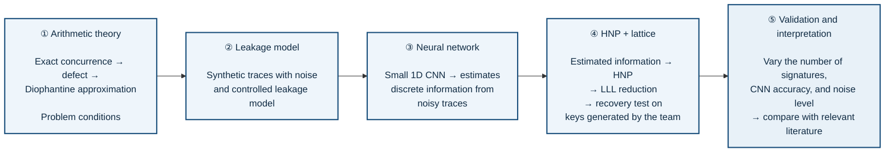

### Languages

[Română](../README.md) | [English](README.md)

<div align="center">

# Research and Innovation Project

<p align="center">
    
</p>

### Contributors:
RoSEF 2026: [Henea Rareș](https://github.com/Vendetaaaa) & [Stadler Rareș](https://github.com/RaresInsine) - first place, gold medal, 100/100

### [LEAKON Showroom](https://leakon.tech/)

</div>

</br>

## Project structure:

```text
RoSEF26-27/
├── .github/
│   └── workflows/
├── docs/
├── informatica/
├── matematica/
├── misc/
├── notebooks/
├── papers/
├── results/
├── tests/
├── tools/
│   └── rosef/
├── website/
├── .gitignore
├── ARCHITECTURE.md
├── CITATION.cff
├── CONTRIBUTING.md
├── LICENSE
├── Q&A.txt
├── README.md
├── SECURITY.md
└── requirements.txt
```

### The project's ethics are described in [docs/ethics.md](../docs/ethics.md)

---

# Core idea

The research project "arithmetic_concurrence" in [papers/arithmetic_concurrence.pdf](../papers/arithmetic_concurrence.pdf) demonstrates two exact theorems about the concurrence of k
families of lines generated by bounded parameters: concurrence occurs only when there is a forced rational relation between the slopes (1), and for k generic families, the condition becomes increasingly rigid and unlikely as k grows (2).

This problem is very similar to the one found in attacks on the cryptographic signature [ECDSA](https://en.wikipedia.org/wiki/Elliptic_Curve_Digital_Signature_Algorithm): the HNP ( [Hidden Number Problem](https://github.com/kelbyludwig/notebooks/blob/master/The%20Hidden%20Number%20Problem.ipynb) ) has been used to attack and recover hundreds of real Bitcoin, Ethereum, and SSH private keys through minor nonce information leaks (Breitner and Heninger, 2019, "Biased Nonce Sense").

Therefore, we aim to:



# From software to hardware

```text
In software we will:
    1. generate the key and nonce
    2. execute ECDSA
    3. calculate the HW/HD model
    4. add artificial noise
In hardware we will:
    1. use the ESP32U Dev Module to acquire the key
    2. implement ECDSA
    3. measure electrical consumption
    4. obtain a real trace
    5. use the trace as input for the CNN
```

The purpose of this stage is to verify whether the theory can become reality.

<div align="center">

### Code. Collaborate. Enjoy!

### #HappyCoding

> Important note: from now on, certain information related to the success of this pipeline will be kept "secret" to prevent certain problems/errors; read [docs/some-results.md](../docs/some-results.md) for more details.

</div>

---

**Would you like to support us? You have several options!**
1. "Star" or "Watch" this project!
2. Follow [Vendeta](https://github.com/Vendetaaaa) and [RaresInsine](https://github.com/RaresInsine)
3. Share this project using the link: [GitHub](https://github.com/Vendetaaaa/LEAKON)
4. Share this project through the website: [Leakon](https://leakon.tech/)
5. Share the QR codes!

<p align="center">
    
    
    
</p>

<p align="center">
    
</p>
